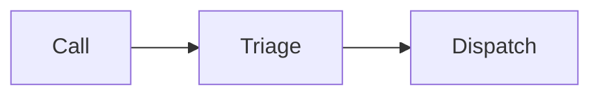
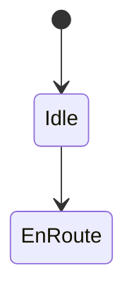

# Aegis Dispatch

[](https://github.com/Decuayer/aegis-dispatch/actions) 

Emergency dispatch simulator :rotating_light:


> [!NOTE]
> Requires Node 20.

> [!WARNING]
> Not for real emergencies.

## Flow





## Features

| Feature | Status |
| ------- | :----: |
| Triage  |   ✅   |

- [x] Map view
- [ ] ~~Voice~~

## Documents

- [Design report](https://github.com/Decuayer/aegis-dispatch/blob/main/docs/design-report.pdf)
- [User manual](docs/user-manual.pdf)

## Installation

```bash
npm install
```

See [Installation](#installation) and [contributing](./CONTRIBUTING.md).
